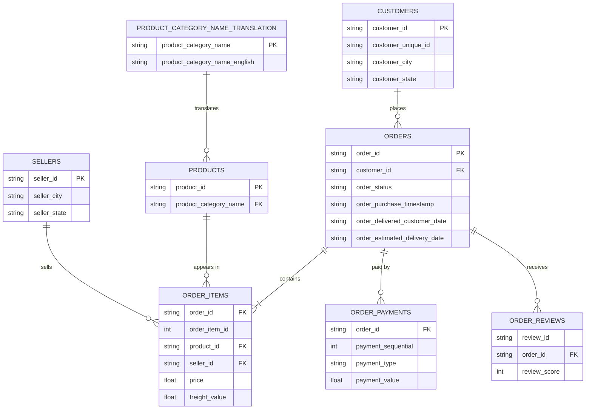

# Olist E-commerce: SQL Business Analysis

SQL analysis of ~100k orders from a Brazilian e-commerce marketplace (2016–2018) to understand revenue trends, customer behaviour and delivery performance, and to recommend where the business could improve.

**Tools:** SQLite · DB Browser for SQLite · Python (pandas) for loading data · SQL (joins, CTEs, window functions)

---

## Business questions

1. How do monthly revenue and order volume trend over time?
2. Which product categories generate the most revenue?
3. How often are orders delivered later than estimated?
4. Do late deliveries lead to lower review scores?
5. Which payment types are most common, and does average order value differ by type?


---

## Key findings

1. How do monthly revenue and order volume trend over time? 

Findings: Monthly revenue from delivered orders (excluding freight, in R$) steadily grew from 2017-01 to 2017-11, reaching a peak of R$988k in revenue and 7289 orders, with 2017-10 to 2017-11 being the highest increase in both fields between months at around R$340k (~50%) and 3800 orders (~85%) The next 3 months show a fluctuation in revenue between R$726k and R$925k before flattening out at R$950k-R$980k for the next 3 months then eased R$840k-R$870k for the remaining months from 2018-06 to 2018-08. 2016-09 to 2016-12 are left out of this analysis as 3 of the 4 months have only either 1 or no orders, likely due to the marketplace only starting up during that period.

Analysis: From the data, we can see that the average order value always remains between R$124-R$149, so growth was driven by order volume, not larger orders. Therefore, the huge spike in revenue and orders in 2017-11 could likely be driven by Black Friday sales. By checking the order volumes by each day in November, we can see that on 24 November there is a huge spike in order volume at 1147 orders while the rest of the days typically average around 200 orders. However, the rest of the daily orders across 2017-11 were also well above the average in 2017-10, therefore the increase likely reflects seasonal growth trends in addition to Black Friday promotions.

Actions: The business should plan stock and delivery capacity for Black Fridays that is several times the average in that month.

2. Which product categories generate the most revenue?

Findings: The top 3 product categories that generate the most revenue (excluding freight, in R$) are health and beauty products, watches, and home textiles and linens (bed_bath_table). The revenue distribution is fairly concentrated to the top 10 product categories as they generate roughly 62.4% of the total revenue, and the top 3 generating around 26% of the total revenue as compared to the other 63 categories. Out of the top 3 product categories, home textiles and linens and health and beauty products have a much higher order count as compared to watches while still generating similar revenue. However, watches have a higher average price per item at ~R$190 while health and beauty and home textiles and linen are at ~R$130 and ~R$93 respectively. Something to note, there are 610 orders with NULL values which account for ~1% of the total revenue, so it should not affect the ranking.

Analysis: The revenue generated from the top few categories come from 2 different models: high-volume, low-price categories(home textiles and linen) and low-price, high-volume categories (watches) 

Actions: With high-volume, low-price models, the business could implement bundles or "buy 1 get 1 free" to increase the likelihood of customers adding more of these items into their baskets. With low-volume, high-price models, the business could implement instalment payment options or gift-season campaigns so that customers will be less hesitant to buy a slightly pricey item.

### Recommendations


### Example result

```sql
-- Late vs on-time deliveries and average review score
SELECT CASE WHEN o.order_delivered_customer_date > o.order_estimated_delivery_date
            THEN 'Late' ELSE 'On time' END AS delivery,
       COUNT(*) AS orders,
       ROUND(AVG(r.review_score), 2) AS avg_review
FROM orders o
JOIN order_reviews r ON o.order_id = r.order_id
WHERE o.order_status = 'delivered'
  AND o.order_delivered_customer_date IS NOT NULL
GROUP BY delivery;
```

| delivery | orders | avg_review |
|----------|--------|------------|
| [Late] | [ ] | [ ] |
| [On time] | [ ] | [ ] |


---

## About the data

**Source:** [Brazilian E-Commerce Public Dataset by Olist](https://www.kaggle.com/datasets/olistbr/brazilian-ecommerce) on Kaggle. The data is not included in this repo because of file size, so download it and put the CSVs in `data/archive/`.

**Size and period:** about [99k] orders placed between [Sep 2016] and [Oct 2018], spread across 9 tables. *(Check these with `SELECT COUNT(*)` and `MIN`/`MAX` on the purchase timestamp.)*

### Entity-relationship diagram



*(The `geolocation` table links only by zip-code prefix and isn't used in this analysis, so it's left out. Only key columns are shown.)*

### Tables at a glance

| Table | One row represents | Notes |
|-------|--------------------|-------|
| `orders` | one order | Status, purchase and delivery timestamps |
| `order_items` | one item within an order | An order can have several items; holds `price` and `freight_value` |
| `customers` | one customer record per order | Use `customer_unique_id` to identify the same person across orders |
| `order_payments` | one payment on an order | An order can have several payments |
| `order_reviews` | one review | [Some orders have more than one review] |
| `products` | one product | Category name is in Portuguese |
| `sellers` | one seller | |
| `product_category_name_translation` | one category | Maps Portuguese names to English |

### Data notes and decisions

- **Timestamps are stored as text** in SQLite; date functions such as `strftime` still work on them.
- **`customer_id` is created per order.** Repeat customers are counted with `customer_unique_id`, not `customer_id`.
- **Missing delivery dates:** orders that were cancelled or not yet delivered have no delivery date, so delivery-time analysis uses delivered orders only.
- **Revenue definition:** revenue is `SUM(price)` from `order_items` for delivered orders, excluding freight. Payments are not joined in the same query, because an order with several items and several payments would be double-counted.
- **Multiple reviews:** [N] orders have more than one review. [Describe how you handled it, e.g. used the latest review per order.]
- **Incomplete months:** [the first and last months of the dataset look partial, so they're excluded from trend comparisons.]

---

## How to reproduce

1. Download the dataset from Kaggle and place the CSVs in `data/archive/`.
2. Run `python load_data.py` to create `olist.db`.
3. Open `olist.db` in DB Browser for SQLite and run the queries in `sql/`.

## Repository structure

```
├── data/archive/     # raw CSVs (not committed)
├── sql/              # one .sql file per business question
├── load_data.py      # loads CSVs into SQLite
└── README.md
```

## What I learned / next steps
