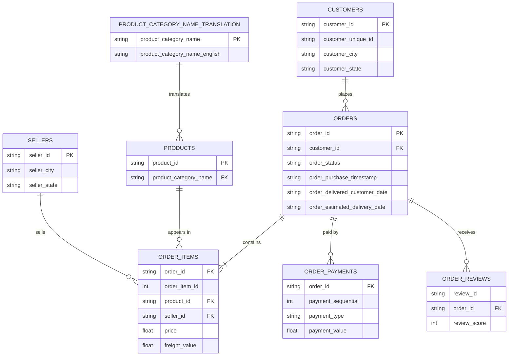

# Olist E-commerce: SQL Business Analysis

SQL analysis of ~100k orders from a Brazilian e-commerce marketplace (2016–2018) to understand revenue trends, customer behaviour and delivery performance, and to recommend where the business could improve.

**Tools:** SQLite · DB Browser for SQLite · Python (pandas) for loading data · SQL (joins, CTEs, window functions)

---

## Business questions

1. How do monthly revenue and order volume trend over time?
2. Which product categories generate the most revenue?
3. How often are orders delivered later than estimated?
4. Do late deliveries lead to lower review scores?
5. Which payment types are most common, and does average order value differ by type?


---

## Key findings


### Recommendations


### Example result

```sql
-- Late vs on-time deliveries and average review score
SELECT CASE WHEN o.order_delivered_customer_date > o.order_estimated_delivery_date
            THEN 'Late' ELSE 'On time' END AS delivery,
       COUNT(*) AS orders,
       ROUND(AVG(r.review_score), 2) AS avg_review
FROM orders o
JOIN order_reviews r ON o.order_id = r.order_id
WHERE o.order_status = 'delivered'
  AND o.order_delivered_customer_date IS NOT NULL
GROUP BY delivery;
```

| delivery | orders | avg_review |
|----------|--------|------------|
| [Late] | [ ] | [ ] |
| [On time] | [ ] | [ ] |


---

## About the data

**Source:** [Brazilian E-Commerce Public Dataset by Olist](https://www.kaggle.com/datasets/olistbr/brazilian-ecommerce) on Kaggle. The data is not included in this repo because of file size, so download it and put the CSVs in `data/archive/`.

**Size and period:** about [99k] orders placed between [Sep 2016] and [Oct 2018], spread across 9 tables. *(Check these with `SELECT COUNT(*)` and `MIN`/`MAX` on the purchase timestamp.)*

### Entity-relationship diagram



*(The `geolocation` table links only by zip-code prefix and isn't used in this analysis, so it's left out. Only key columns are shown.)*

### Tables at a glance

| Table | One row represents | Notes |
|-------|--------------------|-------|
| `orders` | one order | Status, purchase and delivery timestamps |
| `order_items` | one item within an order | An order can have several items; holds `price` and `freight_value` |
| `customers` | one customer record per order | Use `customer_unique_id` to identify the same person across orders |
| `order_payments` | one payment on an order | An order can have several payments |
| `order_reviews` | one review | [Some orders have more than one review] |
| `products` | one product | Category name is in Portuguese |
| `sellers` | one seller | |
| `product_category_name_translation` | one category | Maps Portuguese names to English |

### Data notes and decisions

- **Timestamps are stored as text** in SQLite; date functions such as `strftime` still work on them.
- **`customer_id` is created per order.** Repeat customers are counted with `customer_unique_id`, not `customer_id`.
- **Missing delivery dates:** orders that were cancelled or not yet delivered have no delivery date, so delivery-time analysis uses delivered orders only.
- **Revenue definition:** revenue is `SUM(price)` from `order_items` for delivered orders, excluding freight. Payments are not joined in the same query, because an order with several items and several payments would be double-counted.
- **Multiple reviews:** [N] orders have more than one review. [Describe how you handled it, e.g. used the latest review per order.]
- **Incomplete months:** [the first and last months of the dataset look partial, so they're excluded from trend comparisons.]

---

## How to reproduce

1. Download the dataset from Kaggle and place the CSVs in `data/archive/`.
2. Run `python load_data.py` to create `olist.db`.
3. Open `olist.db` in DB Browser for SQLite and run the queries in `sql/`.

## Repository structure

```
├── data/archive/     # raw CSVs (not committed)
├── sql/              # one .sql file per business question
├── load_data.py      # loads CSVs into SQLite
└── README.md
```

## What I learned / next steps
