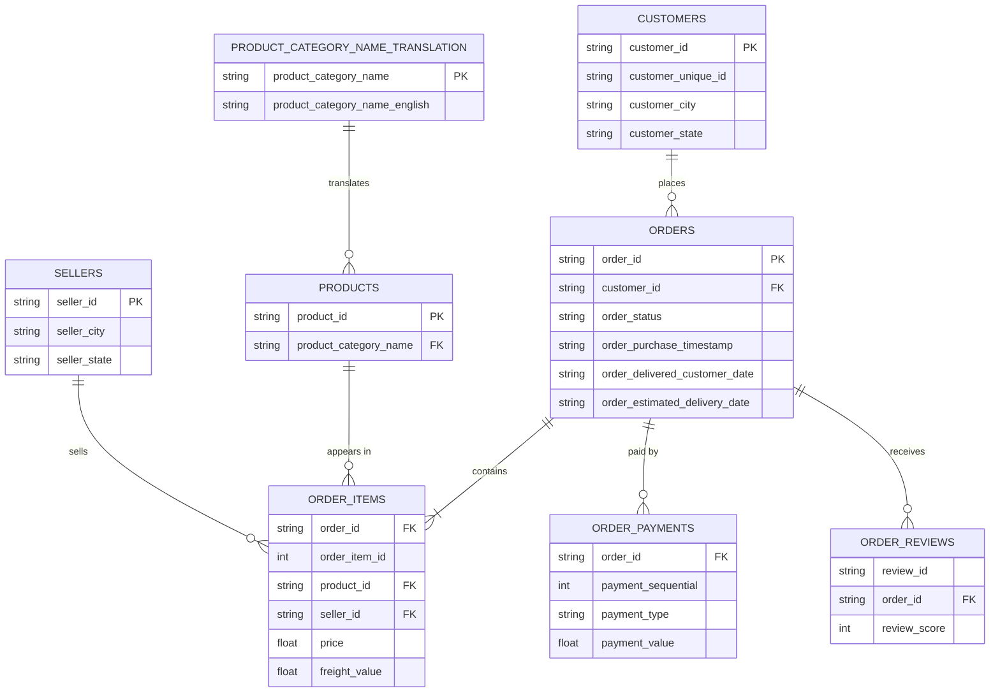

# Olist E-commerce: SQL Business Analysis

SQL analysis of ~100k orders from a Brazilian e-commerce marketplace (2016–2018) to understand revenue trends, customer behaviour and delivery performance, and to recommend where the business could improve.

**Tools:** SQLite · DB Browser for SQLite · Python (pandas) for loading data · SQL (joins, CTEs, window functions)

## Executive Summary

Growth was volume-driven and peaked around Black Friday, but ~7% of orders arrive late and those orders score about 2 points lower. Priorities: reduce the tail of badly delayed deliveries, plan for demand peaks, and test boleto and basket-size offers.

## Recommendations

| # | Recommendation | Evidence | How to test |
|---|----------------|----------|-------------|
| 1 | Reduce the long tail of late deliveries | ~7% of orders arrive late, ~44% of those by more than 8 days; late orders average 2.27 vs 4.29 for on-time ones (Q3, Q4) | Profile orders 8+ days late by seller, state and carrier lane; track an on-time delivery KPI for sellers and carriers |
| 2 | Plan capacity for demand peaks | 1,147 orders on Black Friday vs ~200 on a typical November day (Q1) | Compare the late-delivery rate in Nov 2017 with surrounding months to check whether the surge strained delivery |
| 3 | Grow basket size in high-volume, low-price categories | Growth was volume-driven, with average order value steady at R$124–R$149; home textiles earns revenue through many low-priced orders (Q1, Q2) | Pilot bundles or "add another item" offers and compare basket size with a control group |

---

## Business questions

1. How do monthly revenue and order volume trend over time?
2. Which product categories generate the most revenue?
3. How often are orders delivered later than estimated?
4. Do late deliveries lead to lower review scores?
5. Which payment types are most common, and does average order value differ by type?

---

## Key findings

### 1. How do monthly revenue and order volume trend over time?

**Findings:** Monthly revenue from delivered orders (excluding freight, in R$) steadily grew from 2017-01 to 2017-11, reaching a peak of **R$988k** in revenue and **7289** orders, with 2017-10 to 2017-11 being the highest increase in both fields between months at around **R$340k (~50%)** and **3800** orders **(~85%)**. The next 3 months show a fluctuation in revenue between **R$726k and R$925k** before flattening out at **R$950k-R$980k** for the next 3 months then eased **R$840k-R$870k** for the remaining months from 2018-06 to 2018-08. 2016-09 to 2016-12 are left out of this analysis as 3 of the 4 months have only either 1 or no orders, likely due to the marketplace only starting up during that period.

**Analysis:** From the data, we can see that the average order value always remains between **R$124-R$149**, so growth was driven by order volume, not larger orders. Therefore, the huge spike in revenue and orders in 2017-11 could likely be driven by Black Friday sales. By checking the order volumes by each day in November, we can see that on 24 November there is a huge spike in order volume at **1147** orders while the rest of the days typically average around **200** orders. However, the rest of the daily orders across 2017-11 were also well above the average in 2017-10, therefore the increase likely reflects seasonal growth trends in addition to Black Friday promotions.

**Actions:** The business should plan stock and delivery capacity for Black Fridays that is several times the average in that month.

### 2. Which product categories generate the most revenue?

**Findings:** The top 3 product categories that generate the most revenue (excluding freight, in R$) are health and beauty products, watches, and home textiles and linens (bed_bath_table). The revenue distribution is fairly concentrated to the top 10 product categories as they generate roughly **62.4%** of the total revenue, and the top 3 generating around **26%** of the total revenue as compared to the other 63 categories. Out of the top 3 product categories, home textiles and linens and health and beauty products have a much higher order count as compared to watches while still generating similar revenue. However, watches have a higher average price per item at **~R$190** while health and beauty and home textiles and linen are at **~R$130 and ~R$93** respectively. Something to note, there are 610 orders with NULL values which account for ~1% of the total revenue, so it should not affect the ranking.

**Analysis:** The revenue generated from the top few categories come from 2 different models: high-volume, low-price categories(home textiles and linen) and low-price, high-volume categories (watches) 

**Actions:** With high-volume, low-price models, the business could implement bundles or "buy 1 get 1 free" to increase the likelihood of customers adding more of these items into their baskets. With low-volume, high-price models, the business could implement instalment payment options or gift-season campaigns so that customers will be less hesitant to buy a slightly pricey item.

### 3. How often are orders delivered later than estimated?

**Findings:** Out of the 96470 delivered orders, orders were delivered late 6534 times **(~7%)**. The states with the highest percentage of orders being late are AL **(~24%)**, MA **(~20%)**, and PI **(~16%)**. The deliveries were late by an average of **11.3 days**. States with under 100 orders such as RR and AM are excluded as they are too small to compare.

**Analysis:** Late deliveries are concentrated in states far away from SP, where **~71%** of all orders originate. Cross-state orders were late **8%** of the time, while same-state orders were only late **4.5%** of the time, which could suggest distance being a factor. However, even RJ, a neighbouring state of SP, have **~14%** of its orders being delivered late. Olist's estimated delivery times exceeded the actual days it took across all states **(~8-20 days each)**. Despite this, there are still multiple states with high percentages of late deliveries, which could suggest a long tail of heavily delayed orders and not general slowness. This is proven as **~44%** of deliveries that were late took more than 8 days to reach customers. On deliveries that were late, most of the days were spent during the carrier delivery **(~28 days)** rather than the seller's handling time **(~6 days)**. This likely suggests a lack of optimization in carrier routes.

**Actions:** The business should look into spending more of their resources in reoptimizing their carrier routes or upgrading their choice of transit vehicles to ensure that deliveries are on time as late deliveries may affect customer satisfaction.

### 4. Do late deliveries lead to lower review scores?

**Findings:** Deliveries made on time have an average rating of **4.29** and only **~9%** of them were rated 2 or below. Late deliveries have a noticeably lower rating and considerably higher percentage of ratings that were **2 or below**, at **2.27** and **~62%** respectively. Scores (average) also fall further the later the order arrives, **3.29** for 1-3 days late, **2.11** for 4-7 days late, and **1.7** for more than 7 days late.

**Analysis:** From the findings, we can infer that late deliveries are strongly associated with poor reviews, and the gradient across lateness levels suggests that it isn't just a coincidence. Late orders scored over **2** points lower and were about **7 times** as likely to get a low score. Other factors such as poor customer service or poor product quality can also be reasons why review ratings drop, however we cannot confirm the accuracy of those statements due to limited data.

**Action:** The business should prioritise reducing the longest delays (8+ days late). This could be done by introducing an on-time delivery rate KPI for sellers and carriers.

### 5. Which payment types are most common, and does average order value differ by type?
**Findings:** The most common payment method is by credit card with a usage of **~75%** while also having the highest order value at **~R$163**. Vouchers have the lowest average order value at **~R$93** compared to the rest of the payment methods at **~R$140** to **~R$163**, but that is normal as it is the discounted portion of the purchase. Some things to note, payment value includes freight unlike the revenue in Q1 and Q2, an order paid by 2 types such as credit card and voucher is counted once for each type, and there are a few rows with no payment types but not enough to affect the data.

**Analysis:** The data suggests that larger purchases are usually paid in instalments, starting at **~R$134** in 2-3 instalments to **~R$359** in 11+ instalments. However, another set of data shows the average amount of instalments used in a payment does not go up as the amount spent in an order goes up but is rather all over the place, which indicates that the earlier recommendation in Q2 for more instalment payment options for expensive items is not supported by my current data. Across all product categories, whether high or low priced, most of them are paid by credit card **(~77% to ~84%)** with the exception for computer accessories **(~68%)** as it uses boleto as payment **(~29%)** more than the other categories **(~12% to 20%)**. Computer accessories boleto usage rises as prices go up **(from ~28% to ~34%)** while the rest of the categories are the opposite **(from ~24% to ~15%)**. Failure rates are a negligible factor of this anomaly since they are under 1%.

**Action:** Do not build a category specific instalment strategy as the data shows instalment usage is not affected by order value, stick to one effective instalment option across all categories. Make boleto a first class option for computer accessories, test whether giving boleto specific discounts or pop-up messages suggesting boleto as payment will increase conversion.

## Limitations

1. No cost or margin data, so every recommendation needs a pilot.
2. Findings are associations, not proof of cause (especially delivery vs reviews).
3. Only reviewed orders are in the Q4 analysis, and unhappy customers may be more likely to review.
4. The data is from 2016–2018 and from one marketplace.
5. About 610 orders have no category (~1% of revenue).

## About the data

**Source:** [Brazilian E-Commerce Public Dataset by Olist](https://www.kaggle.com/datasets/olistbr/brazilian-ecommerce) on Kaggle. The data is not included in this repo because of file size, so download it and put the CSVs in `data/archive/`.

**Size and period:** about 99k orders placed between Sep 2016 and Aug 2018, spread across 9 tables.

### Entity-relationship diagram



*(The `geolocation` table links only by zip-code prefix and isn't used in this analysis, so it's left out. Only key columns are shown.)*

### Tables at a glance

| Table | One row represents | Notes |
|-------|--------------------|-------|
| `orders` | one order | Status, purchase and delivery timestamps |
| `order_items` | one item within an order | An order can have several items; holds `price` and `freight_value` |
| `customers` | one customer record per order | Use `customer_unique_id` to identify the same person across orders |
| `order_payments` | one payment on an order | An order can have several payments |
| `order_reviews` | one review | [Some orders have more than one review] |
| `products` | one product | Category name is in Portuguese |
| `sellers` | one seller | |
| `product_category_name_translation` | one category | Maps Portuguese names to English |

### Data notes and decisions

- **Timestamps are stored as text** in SQLite; date functions such as `strftime` still work on them.
- **`customer_id` is created per order.** Repeat customers are counted with `customer_unique_id`, not `customer_id`.
- **Missing delivery dates:** orders that were cancelled or not yet delivered have no delivery date, so delivery-time analysis uses delivered orders only.
- **Revenue definition:** revenue is `SUM(price)` from `order_items` for delivered orders, excluding freight. Payments are not joined in the same query, because an order with several items and several payments would be double-counted.
- **Multiple reviews:** [N] orders have more than one review. [Describe how you handled it, e.g. used the latest review per order.]
- **Incomplete months:** [the first and last months of the dataset look partial, so they're excluded from trend comparisons.]

---

## How to reproduce

1. Download the dataset from Kaggle and place the CSVs in `data/archive/`.
2. Run `python load_data.py` to create `olist.db`.
3. Open `olist.db` in DB Browser for SQLite and run the queries in `sql/`.

## Repository structure

```
├── data/archive/     # raw CSVs (not committed)
├── sql/              # one .sql file per business question
├── load_data.py      # loads CSVs into SQLite
└── README.md
```

## What I learned / next steps
- Joining items and payments double-counts revenue, so I kept them in seperate queries
- Some orders have more than one review, so I averaged scores per order before joining.
- "Late" is measured against Olist's own estimate, which already includes a buffer, so averages alone hid a long tail of heavily delayed orders.
- **Next:** I plan to move on to another project with a dataset related to one of my interests and build a dashboard for it.